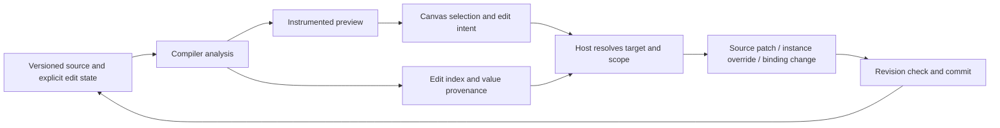

# How can AI-generated code stay visually editable?

> **Let the model express the interface in code. Make each edit explicit about its origin, scope, and owner.**

[简体中文](README.zh-CN.md) · [Read the examples](examples/walkthrough.md) · An engineering reference from [Foundax](https://foundax.com)

An agent can create components, split files, pass props, call functions, and read business data.
Once that code becomes a page, users want to click a heading to change its text,
adjust one card's appearance, or replace the product it displays.

The next question is: **the user selected an element, but what should the system actually change?**

Displayed text may come from a JSX literal, a prop, a list item, a calculation, or a product record.
The same component can appear in several places.
The DOM, visible text, or a source line alone cannot determine the full meaning of an edit.

This project shares Foundax's engineering practice for continuously edited business interfaces:
**keeping agent-written code, merchant edits, and changing business data working together over time.**
Compiler analysis, provenance, and version management serve that goal.

## 1. From Initial Generation to Continued Maintenance

A typical sequence starts with an agent-generated page. A merchant edits the second card and the price color,
the agent adjusts the layout, the backend updates the price, and the merchant selects another product and publishes.
Each step needs to establish who owns earlier changes and what the next edit must preserve.

| User operation | Question for the editor |
| --- | --- |
| Change the second card's heading | Change the component definition, its second call site's prop, or an instance override? |
| Replace the product shown by a card | Change the page's product reference, or the product itself? |
| Edit text after an agent rewrites the layout | Can the element retain its identity? Is its previous source location still valid? |

These questions determine whether generated pages can become maintainable business interfaces.
Even a small canvas edit involves **intent, value provenance, scope, and a revision precondition**.

The [worked examples](examples/walkthrough.md) start with individual operations.
Section 5 connects them into a continuing editing sequence, separating project revisions from backend data versions.
The ordinary TSX and synthetic product data require no model service or Foundax account.

## 2. Why not write DOM changes straight back to code?

The DOM describes one rendering result. Author code describes how to produce those results.
The relationship is not one-to-one:

- One component definition can produce several instances; one `.map()` can produce many cards.
- A data field can appear in a heading, link, and image description.
- Price formatting, concatenation, and conditional branches can produce values with no directly writable literal.
- A CSS rule can affect one element, a component, or every matching element.

The editor first determines the operation's meaning, then selects the appropriate mutation path.
Changing a price's color belongs to presentation; changing the selling price belongs to the business service;
choosing another product changes the page reference.

A constrained component schema remains useful when the component set and editable fields are known.
Allowing agents to author ordinary components, functions, and compositions introduces additional work
to connect code with editing behavior.

## 3. Reference architecture: from selection to mutation

Foundax's internal editor uses compiler instrumentation, provenance analysis, instance edit state,
and versioned mutations. This project abstracts that practice into design documents and static examples,
including simplified contracts and pseudocode.
The full compiler, preview runtime, and visual editor are outside this repository's implementation scope.

### Location: where did the element come from?

The compiler records source nodes, fields, and traceable value origins.
The preview runtime supplies observations about calls and rendered instances.
The edit index belongs to a build revision, and the host uses it to resolve a selection.
Source maps help locate code; field ownership and instance scope require additional semantic information.

### Ownership: who maintains this value?

Authored copy, forwarded props, computed values, and external business fields need different mutation paths.
A selectable value does not automatically permit source replacement, instance overrides, or business writes.

### Scope: what does this change affect?

A component definition, call site, collection member, and runtime occurrence are distinct concepts.
The editor distinguishes “change all these cards” from “change only this one” and preserves that choice in the mutation.

### Continued editing: what happens after the code changes?

Agent changes and canvas edits use the same versioned project state.
Commits check their base revision and trigger a new edit index.
Identities can survive structural changes when correspondence can be established;
ambiguous targets remain unresolved until located again.
Instance content or style overrides are versioned with the source, and preview and publication consume the same effective state.

See the [engineering design](docs/architecture.md) for topology, state ownership, mutation steps, and trade-offs.

## 4. Repository contents

| Content | Purpose |
| --- | --- |
| [Engineering design](docs/architecture.md) | Runtime topology, provenance, edit commands, revisions, and identity lifecycles |
| [Worked examples](examples/walkthrough.md) | Follow individual edits and the separate evolution of project state and business data |
| [Ordinary TSX](examples/page.tsx) | Static samples of component reuse, props, product references, and computed values |
| [Synthetic product data](examples/products.json) | Separate page references from business fields without merchant data |

This is a readable architecture reference. The TSX is an analysis fixture, with no installation or execution commands.
The engineering document's acceptance matrix is intended for evaluating your own implementation.

## 5. Relationship to Agent Business Workspace

[Agent Business Workspace](https://github.com/foundax/agent-business-workspace)
explores how agents use existing business systems while the backend retains control of rules and writes.

This project explores how people continue maintaining generated interfaces through code and a visual canvas.
Both keep model-led creation and composition within explicit host-managed state and mutation boundaries.

## 6. Related Work

Source-based visual editing, value provenance, and content-field mapping have substantial prior work:

- [Onlook](https://github.com/onlook-dev/onlook) provides a public implementation of indexing,
  instrumentation, and visual edits written back to code.
  [Utopia](https://github.com/concrete-utopia/utopia/tree/master/editor/src/core/data-tracing)
  includes React data tracing and its tests.
- [Puck](https://puckeditor.com/docs/integrating-puck/external-data-sources)
  describes component configuration and external data editing.
  [Plasmic](https://docs.plasmic.app/learn/code-components-ref/)
  connects existing React code to visual editing through component and prop metadata.
- [TinaCMS](https://tina.io/docs/contextual-editing/tinafield)
  demonstrates explicit mappings between page elements and content fields.

This project follows Foundax's use cases to explain how these engineering concerns interact in continuously edited
business interfaces, including trade-offs in mutation ownership, instance state, and revision handling.

## 7. Discussion and contributions

Share concrete cases involving component reuse, conditional rendering, data binding, and continued editing.
We welcome discussion of provenance coverage, identity reconciliation, and edit semantics.
See [CONTRIBUTING.md](CONTRIBUTING.md) for contribution guidance.

If you are building AI website tools, a CMS, internal tools, or visual development software,
contact the Foundax team at [contact@novariseintl.com](mailto:contact@novariseintl.com).

## License and deployment responsibilities

Documentation and examples use the [MIT License](LICENSE).
When connecting real models, user code, or business data, implementers are responsible for applicable
model deployment, data security, and cross-border data-transfer requirements in the jurisdictions involved.

