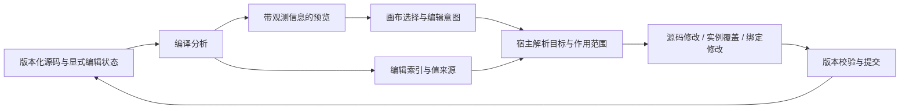

# AI 写出的代码，如何继续被人可视化编辑？

> **让模型用代码表达界面，让编辑器明确每一次修改的来源、范围与归属。**

[English](README.md) · [阅读案例](examples/walkthrough.zh-CN.md) · 来自 [Foundax](https://foundax.com) 的工程参考

Agent 可以生成组件、拆分文件、传递参数、调用函数，也可以从业务系统读取数据。
当这些代码变成页面后，用户希望直接点击标题改文案、调整某张卡片的样式，或替换正在展示的商品。

问题随之而来：**用户点到了一个元素，系统究竟应该修改哪里？**

同一段文字可能来自 JSX 字面量、组件参数、列表数据、计算结果或商品记录。
同一个组件也可能出现在页面的多个位置。仅凭 DOM、显示文字或文件行号，无法确定一次编辑的完整含义。

这个项目分享 Foundax 在业务界面持续编辑中的工程实践：
**Agent 调整代码、商家修改局部内容与外观、后台更新商品数据之后，如何让它们继续协作。**
编译分析、来源追踪与版本管理共同服务于这个目标。

## 1. 从一次生成，到多轮共同维护

一个典型过程是：Agent 生成页面，商家修改第二张卡片和商品价格的颜色，
Agent 再调整布局，后台更新售价，商家最后替换展示商品并发布。
每一步都需要知道前一次改动由谁维护，以及本次修改应该保留什么。

| 用户的操作 | 编辑器需要回答的问题 |
| --- | --- |
| 修改第二张卡片的标题 | 改组件定义、第二个调用点的参数，还是该实例的内容覆盖？ |
| 替换卡片正在展示的商品 | 更换页面的商品引用，还是修改商品本身？ |
| Agent 重写布局后继续修改文字 | 之前的元素身份还能沿用吗？旧的源码位置是否已经失效？ |

这些问题决定了生成页面能否成为可长期维护的业务界面。
一次看起来很小的画布操作，实际上包含了**编辑意图、值的来源、作用范围和版本条件**。

从 [案例推演](examples/walkthrough.zh-CN.md) 的基础操作开始，第 5 节将它们串成完整的持续编辑过程，
同时区分项目版本与后台数据版本。案例提供普通 TSX 与合成商品数据，无需模型服务或 Foundax 账号。

## 2. 为什么不直接把 DOM 修改写回代码？

DOM 描述一次渲染的结果，作者代码描述如何生成这些结果。两者并非一一对应：

- 一个组件定义可以产生多个渲染实例；一次 `.map()` 可以产生多张卡片。
- 同一个数据字段可能出现在标题、链接和图片说明中。
- 格式化价格、拼接文本和条件分支会生成没有直接可写字面量的显示结果。
- CSS 规则可能影响一个元素、整个组件，或者同一类型的所有元素。

因此，编辑器需要先确定操作的语义，再选择对应的修改入口。
例如，修改“商品价格的颜色”属于展示层；修改“商品售价”属于业务服务；更换商品则属于页面引用。

受约束的组件 Schema 仍然适合组件集合固定、字段结构明确的系统。
当产品允许 Agent 使用普通组件、函数和组合方式创作时，需要进一步处理代码与编辑行为之间的对应关系。

## 3. 参考架构：从选择到修改

Foundax 内部编辑器已有编译插桩、来源分析、实例编辑状态与版本化修改机制。
本项目将这些实践抽象为设计说明和静态案例；公开内容包含简化的数据契约与伪代码。
完整编译器、预览运行时和可视化编辑器不包含在此仓库中。

### 定位：元素来自哪里？

编译器记录源码节点、字段和可追踪的值来源；预览运行时提供本次渲染的调用与实例信息。
编辑索引与构建版本关联，宿主据此解析选择目标。
Source Map 可帮助定位代码，但字段归属和实例范围还需要额外的语义信息。

### 归属：这个值由谁维护？

可直接修改的作者文案、通过参数传入的内容、派生值和外部业务字段需要不同的处理方式。
画布能够选中一个值，不代表它具备源码替换、实例覆盖或业务写入的权限。

### 范围：这次修改影响谁？

组件定义、某个调用点、集合成员和单次渲染出现是不同概念。
编辑器应明确区分“修改所有同类卡片”和“只修改这里”，并在提交中保留这个选择。

### 连续编辑：代码变化后如何接着工作？

Agent 与画布编辑使用同一版本化项目状态。提交检查基准版本，成功后重建对应索引。
元素身份可以在可确认的结构变更中延续；发生歧义时，保留未解析状态并重新定位。
实例样式或内容覆盖与源码一起纳入版本，预览和发布消费相同的有效状态。

实现步骤、状态归属和取舍见 [工程设计说明](docs/architecture.zh-CN.md)。

## 4. 本仓库提供什么

| 内容 | 用途 |
| --- | --- |
| [工程设计](docs/architecture.zh-CN.md) | 运行时拓扑、来源分析、编辑命令、版本与身份生命周期 |
| [案例推演](examples/walkthrough.zh-CN.md) | 从单次修改到多轮编辑，说明项目状态与业务数据各自怎样演进 |
| [普通 TSX 示例](examples/page.tsx) | 组件复用、调用参数、商品引用与计算值的静态样本 |
| [合成商品数据](examples/products.json) | 区分页面引用和业务字段，不包含真实商家数据 |

本仓库是可阅读的架构参考，TSX 是供分析的源码样本，没有安装或运行命令。
工程文档中的验收矩阵用于验证读者自己的实现。

## 5. 与业务 Agent 项目的关系

[Agent Business Workspace](https://github.com/foundax/agent-business-workspace)
讨论 Agent 如何利用已有业务系统组织工作，由后端保持对业务规则与写入的控制。

本项目讨论 Agent 生成界面后，用户如何继续通过代码和画布共同维护它。
两者共享一个原则：模型负责创作与组合，宿主负责明确的状态与修改边界。

## 6. 相关工作

源码可视化编辑、值来源追踪和内容字段映射已有丰富实践，可以结合以下项目阅读：

- [Onlook](https://github.com/onlook-dev/onlook) 的公开实现展示代码索引、插桩与可视化修改回写；
  [Utopia](https://github.com/concrete-utopia/utopia/tree/master/editor/src/core/data-tracing)
  提供 React 数据来源追踪及相关测试。
- [Puck](https://puckeditor.com/docs/integrating-puck/external-data-sources)
  展示组件配置与外部数据编辑；[Plasmic](https://docs.plasmic.app/learn/code-components-ref/)
  通过组件与属性元数据连接已有 React 代码和可视化编辑。
- [TinaCMS](https://tina.io/docs/contextual-editing/tinafield)
  展示页面元素与内容字段之间的显式映射。

本项目围绕 Foundax 的实际需求，说明这些工程问题在持续编辑的业务界面中如何相互影响，
并公开修改归属、实例状态和版本处理的设计取舍。

## 7. 参与讨论

欢迎分享组件复用、条件渲染、数据绑定和连续编辑中的具体案例，
讨论来源分析的覆盖范围、身份延续策略与编辑语义。
贡献方式见 [CONTRIBUTING.md](CONTRIBUTING.md)。

如果你正在构建 AI 建站、CMS、内部工具或可视化开发产品，
可以通过 [contact@novariseintl.com](mailto:contact@novariseintl.com) 与 Foundax 团队交流。

## 许可与部署责任

文档与示例采用 [MIT License](LICENSE)。接入真实模型、用户代码或业务数据时，
实施方需按所在地及业务涉及地区的要求处理模型部署、数据安全和跨境数据传输。

